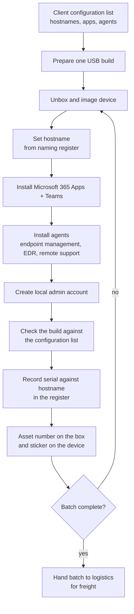

# Bulk Device Deployment

Staging and imaging 52 Lenovo devices (20 laptops, 30 tiny desktops, 2 workstations) in the office for a client's remote site, then shipping them in batches ready to plug in. 50 devices were built, checked and shipped within two days.

> Case study. Scripts, records and client details are not published. This repository documents the process. All names and values shown are generic.

## Process

## Batching

Devices were built in batches by type as the hardware arrived: the 30 desktops first, then the 20 laptops, then the 2 workstations on the day they arrived. Each batch went to freight as soon as it was checked, so the site received working devices in stages rather than waiting for the whole order.

## What made it fast

- One tested USB build for every device of the same model instead of building each one by hand.
- A naming register prepared before the hardware arrived, so hostname, serial and asset number were recorded as each device was built, not afterwards.
- A fixed checklist per device so every build was checked the same way before it shipped.

## Deliverables

- Serial and hostname register (Excel)
- Build guide describing how the process works, so the next rollout can follow it
- All scripts and records filed in SharePoint against the job

## Stack

Windows, Microsoft 365 Apps, endpoint management agent, EDR agent, remote support agent, PowerShell, Excel.
